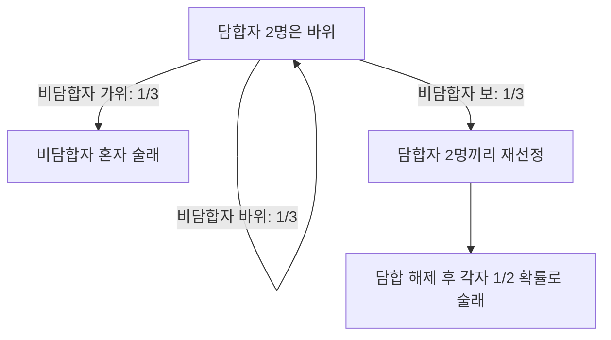

# 같은 손을 내면 더 유리할까?

**가위바위보에서 같은 손을 내기로 약속한 사람은 다른 사람보다 술래를 피할 확률이 높을까?**

[빠더너스 영상](https://youtu.be/YJckrnOUaoM)에서 비용 부담자를 정할 때 일부가 미리 같은 손을 내기로 약속하는 모습을 보고 시작한 개인 프로젝트다. 처음에는 개인 생존 확률에 큰 차이가 없으리라 예상했다. 초기 시뮬레이션에서 차이를 관측한 뒤, 재현 가능한 실험과 정확 확률 계산으로 발전시켰다. 영상 링크와 장면 설명은 프로젝트 작성자 제공이며, 영상의 세부 규칙과 모델의 일치는 별도로 확인하지 않았다.

## 결과부터 보기

- **[개선된 인터랙티브 리포트](outputs/main/report.html)**: 조건 선택, 생존율 차이와 신뢰구간, 정확 확률, 첫 투구의 분기, 개인별 대조군과 게임 예시
- [최종 분석 데이터](outputs/main/results.json) · [다른 시드 확인 데이터](outputs/seed-check/results.json)
- [실험 명세와 계산 방법](project.md) · [포트폴리오 설명](PORTFOLIO.md)

정확 계산 결과(독립·균등한 비담합자, 고정 손 담합자, 아래 선정 규칙 기준):

| 참가자 | 담합자 | 술래 | 담합자 개인 생존율 | 비담합자 개인 생존율 | 차이 |
|---:|---:|---:|---:|---:|---:|
| 4 | 2 | 1 | 5/6 | 2/3 | +16.67%p |
| 4 | 2 | 2 | 1/2 | 1/2 | 0%p |
| 6 | 2 | 2 | 7/10 | 13/20 | +5%p |
| 6 | 3 | 2 | 3/4 | 7/12 | +16.67%p |

**이 모델에서는 담합이 유리한 조건과 차이가 없는 조건이 모두 존재한다.** 이는 사람의 심리나 적응 전략까지 포함한 일반적 결론이 아니다.

## 왜 차이가 생길까?

담합자는 같은 손을 내므로 함께 승패 분기로 들어간다. 패자가 술래 정원보다 많으면 패자끼리 다시 하고, 적으면 패자는 확정하고 직전 승자 중에서 부족한 술래를 정한다. 이런 분기 구조가 최종 개인 확률을 바꾼다.

손으로 계산할 수 있는 예로, **3명 중 2명이 담합하고 술래 1명을 정할 때**를 보자. 담합자가 바위를 내면 비담합자의 바위는 무승부, 가위는 비담합자의 단독 패배, 보는 담합자 2명의 패배다. 유효 투구에서 두 경우의 확률은 각각 1/2이다. 담합자 둘이 패배하면 담합을 풀고 둘 중 하나를 정하므로, 담합자 개인의 술래 확률은 1/2 × 1/2 = 1/4, 비담합자는 1/2이다. 생존율은 각각 3/4, 1/2이다.



## 재현하기

Python 3.10 이상. 새 분석 경로에는 외부 패키지가 필요 없다. 검증 환경은 Python 3.12.14다.

```powershell
python -m unittest test_research -v
python simulate.py --seed 20261109 --trials 100000 --output outputs/my-run
python simulate.py --seed 20261110 --trials 20000 --output outputs/my-seed-check
```

기본 조건은 전체 4·6명, 담합 2·3·4명, 술래 1·2명에서 유효한 10개 조합이다. `--players 6 --colluders 3 --catchers 2`로 한 조건을 선택할 수 있다. 도움말: `python simulate.py --help`.

기존 결과를 보호하기 위해 **비어 있지 않은 출력 폴더에는 실행하지 않는다.** 동일 옵션·시드·Python 버전·소스 코드에서 수치 결과와 CSV가 재현된다. 실행 시각 등 메타데이터는 달라진다.

## 구조와 분석 개선

| 파일 | 역할 |
|---|---|
| engine.py | 구조화된 게임 결과와 선택적 투구 기록 |
| exact.py | 다항분포 열거·상태 재귀·유리수로 정확 확률 계산 |
| analysis.py | 게임 단위 표준오차·신뢰구간·Holm 보정 |
| simulate.py | 시드별 실행, 원자료 CSV·환경·소스 해시 기록 |
| report.py | 외부 연결 없이 열리는 HTML 리포트 생성 |
| test_research.py | 독립 완전 열거와 비교, 분기·재현성·확률 검증 |

초기 구현은 콘솔 출력을 파싱하고, 집단 신뢰구간에서 같은 게임 참가자들을 독립처럼 합쳤다. 개선 구현은 게임 결과를 직접 반환하고 **게임별 집단 생존 비율의 차이**를 독립 관측치로 분석한다. 전원 무작위 기준과의 비교는 보조 지표다. 중앙값 대신 효과 크기(%p), 신뢰구간, 정확 확률을 제시한다.

검증 기록: [검증 요약](VALIDATION.md), [수치 검증](outputs/verification.json), [브라우저 검증](outputs/browser-verification.json). `python verify_outputs.py`로 저장된 두 실험의 원자료와 요약을 다시 검산할 수 있다. 선택적인 화면 검사는 Playwright와 Edge가 설치된 개발 환경에서 `node visual_check.cjs`로 실행한다. 리포트를 열거나 실험을 수행하는 데 Node.js는 필요 없다.

## 초기 결과와 기여

루트의 `test.py`, `results.json`, `report.html`은 초기 탐색 자료로 보존했다. 초기 test.py는 NumPy를 사용하지만 새 분석 경로에서는 호출하지 않는다. **최신 결과는 outputs/main 아래 파일이다.**

작성자가 혼자 시작한 프로젝트이며, 질문·초기 예상·개인 진행 사실은 작성자 설명에 따른다. 이번 고도화의 코드·테스트·문서는 Codex의 도움으로 작성하고 실행했다. 최종 포트폴리오에서는 직접 설명하고 검증한 판단과 도구의 도움을 구분한다.

한계: 균등·독립 선택 가정, 정해진 술래 선정 규칙, 고정 손 전략만 다룬다. 상대의 학습·심리전·변형 규칙·영상의 실제 비용 분담 구조는 후속 과제다. 계산은 유한 상태에서 정확하지만, 선택한 모델의 현실 적합성까지 보장하지 않는다.
